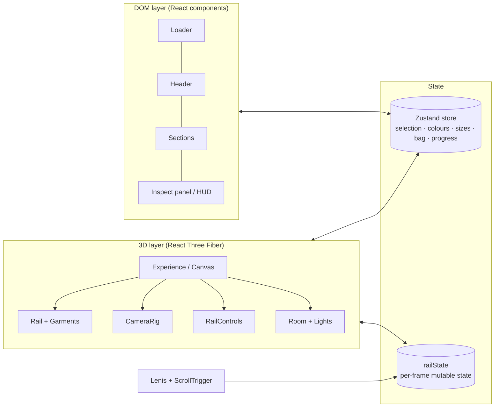

# FERROVA

> An interactive 3D wardrobe for the web. Slide garments along a clothing rail, pull one forward, turn it in the light and make it yours.


---

## Table of Contents

- [Overview](#overview)
- [Project Objectives](#project-objectives)
- [Features](#features)
- [Technologies Used](#technologies-used)
- [UI/UX Design](#uiux-design)
- [Project Architecture](#project-architecture)
- [Installation](#installation)
- [Getting Started](#getting-started)
- [Project Structure](#project-structure)
- [Configuration](#configuration)
- [Screenshots & Preview](#screenshots--preview)
- [Video Presentation](#video-presentation)
- [Performance & Optimization](#performance--optimization)
- [Responsive Design](#responsive-design)
- [Security](#security)
- [Future Improvements](#future-improvements)
- [Author](#author)
- [License](#license)

---

## Overview

**FERROVA** is a single-page, real-time 3D fashion experience built with React and Three.js. Instead of a flat product grid, the collection hangs on a steel rail inside a softly lit boutique: visitors drag the rail to browse, click a piece to bring it forward, rotate it, switch its colourway, choose a size and add it to a bag.

The nine garments are not loaded from model files or images. Each one is **modelled procedurally in code** from flat pattern pieces, and every fabric (jersey, rib knit, oxford, twill, selvedge denim, fleece, wool, silk and lambskin) has its own generated texture and material.

## Project Objectives

- **Bring touch back to online fashion**: recreate the feeling of browsing a physical rail rather than scrolling a grid of photos.
- **Show material, not just colour**: make drape, weave, sheen and weight readable on screen.
- **Stay fast and fluid**: keep interactions smooth on desktop, tablet and mobile.
- **Degrade gracefully**: never leave the visitor on a loading screen, even when WebGL is unavailable or the 3D scene fails.
- **Keep the code clean**: reusable React components with a clear separation between the 3D layer, the UI layer and shared state.

## Features

### 3D experience

| Feature | Description |
| --- | --- |
| Interactive clothing rail | Drag, swipe, horizontal trackpad scroll or arrow keys move the rail; release velocity adds inertia and the rail settles on the nearest hanger. |
| Garment physics | Each piece swings like a pendulum as the rail moves, trails behind the motion and settles with a soft overshoot. Longer pieces swing more slowly. |
| Inspect mode | Clicking a garment lifts it off the rail toward the camera, while the camera frames it beside the detail panel. |
| Free rotation | Drag to turn the inspected piece; it auto-rotates gently when left idle. |
| Live colourways | Each piece has three colourways; switching animates the fabric colour and sheen in real time. |
| Procedural garments | Coat, merino crewneck, denim trucker, jersey tee, silk slip dress, leather biker, pleated trousers, hoodie and oxford shirt, with collars, lapels, pockets, buttons, zips and drawcords. |
| Boutique environment | Plaster wall with arches, ceiling cove light, reflective stone floor, travertine bench with folded knits, and floating dust particles. |
| Scroll-driven camera | Scrolling moves the camera through four shots: the rail, a fabric close-up, a wide view of the collection and a low closing shot. |

### Interface

| Feature | Description |
| --- | --- |
| Loading screen | Animated wordmark with a counter that follows real loading progress. |
| Header navigation | Section links with an active-section indicator, plus a live bag counter. |
| Rail HUD | Current piece, index, category and price, with previous/next controls and progress dots. |
| Detail panel | Category, name, price, description, colour swatches, size selector, "Add to bag" and a specifications list (fabric, weight, fit, origin). |
| Collection list | All nine pieces with colour swatch and price; any row opens that piece in inspect mode. |
| Toast notifications | Confirmation when a piece is added to the bag. |
| Custom cursor | A follower ring on desktop that labels the next action (*Drag*, *View*, *Turn*). |

### Keyboard controls

| Key | Action |
| --- | --- |
| `←` / `→` | Move the rail, or switch to the previous / next piece while inspecting |
| `Enter` | Inspect the centred piece |
| `Esc` | Close the detail panel and return to the rail |

## Technologies Used

| Technology | Version | Role |
| --- | --- | --- |
| [React](https://react.dev/) | 19.3 | UI components and application structure |
| [Vite](https://vite.dev/) | 6.4 | Development server and production bundler |
| [Three.js](https://threejs.org/) | 0.176 | WebGL rendering, geometry, materials and lighting |
| [React Three Fiber](https://r3f.docs.pmnd.rs/) | 9.8 | Declarative Three.js scene inside React |
| [Drei](https://drei.docs.pmnd.rs/) | 10.7 | Environment lighting, reflective floor, rounded boxes, sparkles and adaptive performance monitoring |
| [GSAP](https://gsap.com/) + ScrollTrigger | 3.15 | Timelines, UI transitions, scroll-scrubbed camera and reveal animations |
| [@gsap/react](https://gsap.com/resources/React/) | 2.1 | `useGSAP` hook with automatic cleanup |
| [Lenis](https://lenis.darkroom.engineering/) | 1.3 | Smooth scrolling, synchronised with ScrollTrigger |
| [Zustand](https://zustand.docs.pmnd.rs/) | 5.0 | Lightweight global UI state |
| [Delaunator](https://github.com/mapbox/delaunator) | 5.1 | Triangulation used to build the garment meshes |

**Fonts:** *Instrument Serif* and *Manrope*, loaded from Google Fonts.

## UI/UX Design

FERROVA borrows the language of a quiet, high-end atelier.

- **Palette:** warm stone and plaster neutrals (`#e7e1d7`, `#f6f2ec`), a deep ink for text (`#1c1a17`) and a single terracotta accent (`#a8603f`), all defined as CSS custom properties.
- **Typography:** large editorial headlines in *Instrument Serif* (with italic accents) paired with *Manrope* for interface text.
- **Glass surfaces:** navigation, HUD, panels and lists use translucent frosted-glass cards so the 3D scene stays visible behind the content.
- **Motion:** expo-style easing throughout: line-by-line headline reveals, staggered panel content, a curtain-style loader exit and a camera fly-in on arrival.
- **Feedback:** hover lifts garments slightly toward the viewer, the cursor labels the next action, and every bag addition is confirmed with a toast.
- **Lighting as design:** a warm key light with soft shadows on the wall, a cool fill, and a studio environment that brings out sheen and texture.
- **Accessibility:** buttons carry ARIA labels, swatches and sizes expose `aria-pressed`, focus states are visible, and `prefers-reduced-motion` is respected.

## Project Architecture

The application is split into three layers that communicate through a small shared state.



**Key design decisions**

- **Two kinds of state.** User-facing state (selected piece, colours, sizes, bag, loading progress) lives in a Zustand store. Values that change every frame (rail offset, velocity, camera targets) live in a plain mutable object (`railState.js`), so 60 fps motion never triggers React re-renders.
- **Layered camera.** `CameraRig` blends three poses each frame: the scroll pose (driven by a GSAP ScrollTrigger timeline), the intro fly-in, and the inspect close-up, which is framed to sit beside the detail panel or above the mobile bottom sheet.
- **Procedural modelling pipeline.**
  1. `shapes.js` defines flat pattern pieces (body, sleeves, collars, pockets, bands) as 2D shapes.
  2. `pillow.js` triangulates each piece on an even grid (Delaunator), then inflates it front and back with a rounded edge to give it volume.
  3. `garmentFactory.js` drapes the pieces with folds, assembles them per garment type and adds buttons, zips and drawcords on the cloth surface.
  4. `fabric.js` paints tileable weave textures on a canvas and builds `MeshPhysicalMaterial`s with sheen and clearcoat.
- **Resilient loading.** `preload.js` builds textures and geometry in small chunks before the scene mounts, shaders are compiled ahead of the reveal, and an error boundary plus timeouts guarantee that the site always opens.

## Installation

### Prerequisites

| Requirement | Notes |
| --- | --- |
| [Node.js](https://nodejs.org/) | A version supported by Vite 6 (Node 18 or 20+); the project was developed with Node 20 |
| npm | Installed with Node.js |
| A WebGL-capable browser | Recent Chrome, Edge, Firefox or Safari |

### Install dependencies

```bash
cd ferrova   # or the folder you cloned the project into
npm install
```

## Getting Started

### Run the development server

```bash
npm run dev
```

Vite serves the site at **http://localhost:5173** by default. The server is also exposed on your local network (`host: true`), so you can open it from a phone or tablet on the same Wi-Fi.

### Build for production

```bash
npm run build
```

The optimised bundle is written to `dist/`.

### Preview the production build

```bash
npm run preview
```

### Available scripts

| Script | Command | Description |
| --- | --- | --- |
| `dev` | `vite` | Start the development server with hot module replacement |
| `build` | `vite build` | Create an optimised production build in `dist/` |
| `preview` | `vite preview` | Serve the production build locally |

## Project Structure

```text
ferrova/
├── index.html                  # HTML entry: metadata, fonts, root element
├── package.json
├── vite.config.js              # Dev server and chunk-splitting configuration
├── public/
│   └── favicon.svg
└── src/
    ├── main.jsx                # React entry point
    ├── App.jsx                 # Page composition: stage, header, sections, overlays
    ├── components/             # DOM interface
    │   ├── Loader.jsx          # Loading screen with real progress and safety timeout
    │   ├── Header.jsx          # Brand, section navigation, bag counter
    │   ├── Hero.jsx            # Opening section
    │   ├── Craft.jsx           # Craft and materials section
    │   ├── Collection.jsx      # Collection list
    │   ├── Outro.jsx           # Closing section and footer
    │   ├── RailHUD.jsx         # Rail controls and current-piece info
    │   ├── InspectPanel.jsx    # Product detail panel
    │   ├── Toast.jsx           # Add-to-bag confirmation
    │   └── Cursor.jsx          # Desktop follower cursor
    ├── three/                  # 3D layer (React Three Fiber)
    │   ├── Experience.jsx      # Canvas, error boundary, ready signal, performance monitor
    │   ├── Room.jsx            # Wall, arches, floor, bench, cove light
    │   ├── Lights.jsx          # Key/fill lights and studio environment
    │   ├── Rail.jsx            # Steel rail, brackets and garments
    │   ├── Garment.jsx         # Garment mesh, sway physics, hover and inspect transitions
    │   ├── Hanger.jsx          # Wooden and clip hangers
    │   ├── RailControls.jsx    # Drag, inertia, snapping and wheel input
    │   ├── CameraRig.jsx       # Scroll, intro and inspect camera blending
    │   ├── railState.js        # Per-frame shared state and rail helpers
    │   ├── geometry/
    │   │   ├── shapes.js       # 2D pattern pieces
    │   │   ├── pillow.js       # Triangulation and inflation of pattern pieces
    │   │   └── garmentFactory.js # Garment assembly, drape and details
    │   └── materials/
    │       └── fabric.js       # Procedural weave textures and materials
    ├── store/
    │   └── useCloset.js        # Zustand store
    ├── data/
    │   └── garments.js         # Catalogue and scene constants
    ├── lib/
    │   ├── preload.js          # Chunked scene preparation, font and WebGL checks
    │   ├── useSmoothScroll.js  # Lenis + ScrollTrigger camera timeline
    │   ├── useReveal.js        # Scroll-triggered reveal animations
    │   ├── useKeyboard.js      # Keyboard shortcuts
    │   ├── useMediaQuery.js    # Media-query hook
    │   └── scroll.js           # Shared Lenis instance and scroll helper
    └── styles/
        └── global.css          # Design tokens, layout and responsive rules
```

## Configuration

The project needs **no environment variables**. Everything is configured in code:

| File | What you can configure |
| --- | --- |
| `src/data/garments.js` | The catalogue: name, category, price, garment type, hanger, fabric, hardware, look (roughness, sheen, bump, clearcoat), colourways, description, specifications and sizes. Also scene constants: `RAIL_Y`, `SPACING`, `FOCUS_Z`. |
| `src/styles/global.css` | Design tokens in `:root` (colours, fonts, gutter, easing, radius) and responsive breakpoints. |
| `src/lib/useSmoothScroll.js` | Camera poses for each scroll section and Lenis smoothing. |
| `src/components/Loader.jsx` | `MIN_DISPLAY` (minimum loader time, 900 ms) and `MAX_WAIT` (safety timeout, 12 s). |
| `src/lib/preload.js` | Progress budget per loading stage and font timeout. |
| `vite.config.js` | Dev server port (`5173`), network exposure and vendor chunk splitting. |

**Example: adding a colourway**

```js
// src/data/garments.js
colors: [
  { name: 'Camel', hex: '#b88a5c' },
  { name: 'Charcoal', hex: '#3b3a3a' },
  { name: 'Ivory', hex: '#e2d9c8' },
],
```

> New garments must use one of the existing `type` values (`tee`, `sweater`, `hoodie`, `shirt`, `coat`, `dress`, `biker`, `trucker`, `trousers`) unless a new builder is added to `garmentFactory.js`.

## Screenshots & Preview

No screenshots are included in the repository yet. To add them, place images in a folder such as `docs/screenshots/` and reference them here:

```md


```

Suggested views to capture: the hero with the rail, inspect mode with the detail panel, the wide collection shot, and the mobile bottom-sheet layout.

## Video Presentation

A screen-recorded walkthrough of the site has been produced. It covers the loading sequence, rail browsing, inspect mode with rotation and colourways, the add-to-bag flow, the scroll story and header navigation. The video file is not stored in this repository.

To feature it here, upload the video (for example to a GitHub release, YouTube or Vimeo) and embed a thumbnail link:

```md
[](VIDEO_URL)
```

## Performance & Optimization

| Technique | Benefit |
| --- | --- |
| Chunked scene preparation | Textures and garment meshes are built one per task before the scene mounts, so the loader keeps animating instead of freezing. |
| Build-once caching | Every geometry and texture is generated once and reused. |
| Shader pre-compilation | `compileAsync` prepares shaders before the reveal, avoiding a first-frame hitch. |
| Proxy hit-testing | Pointer events use a simple invisible box per garment instead of raycasting dense cloth meshes. |
| Frame state outside React | Rail and camera motion update a mutable object, never React state. |
| Adaptive quality | Drei's `PerformanceMonitor` lowers the pixel ratio and disables floor reflections on slower devices. |
| Device-aware settings | Phones and touch devices get a lower pixel ratio, smaller shadow maps, fewer particles and no floor reflections. |
| Vendor chunk splitting | `three`, React Three Fiber/Drei and GSAP/Lenis are emitted as separate chunks for better caching. |
| Resilient loading | Fonts are awaited with a timeout, a minimum display time avoids flashes, and a 12-second safety net reveals the site even if animation frames stall. |
| Graceful fallback | Without WebGL, or if the scene fails, the site loads with a short notice instead of the 3D stage. |

## Responsive Design

| Breakpoint | Adaptation |
| --- | --- |
| > 1100 px | Full desktop layout: centred glass navigation, detail panel on the right, camera offset to keep the garment beside it. |
| ≤ 1100 px | Tighter navigation spacing. |
| ≤ 820 px | Navigation collapses to brand + bag; the detail panel becomes a bottom sheet and the camera lifts the garment above it; the HUD spans the full width. |
| ≤ 420 px | Smaller hero title and buttons; the HUD "View" label is hidden. |
| Portrait screens | The camera pulls back automatically so the rail still reads at a glance. |

Touch is supported natively: horizontal swipes move the rail while vertical swipes scroll the page (`touch-action: pan-y`). The HUD respects the bottom safe-area inset, and sections and panels use `svh` units so they size correctly in mobile browsers.

## Security

FERROVA is a fully static, client-side application:

- **No backend, accounts or payments.** The bag is a front-end demonstration held in memory; nothing is submitted or persisted.
- **No personal data collected.** The site uses no cookies, analytics or forms.
- **No secrets.** The project contains no API keys or environment variables.
- **Third-party requests:** fonts are loaded from Google Fonts (`fonts.googleapis.com` / `fonts.gstatic.com`).
- **Recommended for deployment:** serve over HTTPS, add a Content Security Policy that allows Google Fonts, and run `npm audit` regularly to keep dependencies up to date.

## Future Improvements

- Load scanned or artist-made garments as compressed glTF/GLB models alongside the procedural ones.
- Persist the bag and add a real checkout flow connected to a backend.
- Fabric zoom with a close-up macro view of the weave.
- Additional garment types and seasonal collections.
- Internationalisation and multi-currency pricing.
- Automated tests and continuous integration.
- Screenshots and an embedded video in this README.

## Author

**Dhia Saied**

## License

No license has been specified for this project yet. All rights are reserved by the author until a license is added. To open-source it, add a `LICENSE` file (for example MIT) and update this section.
